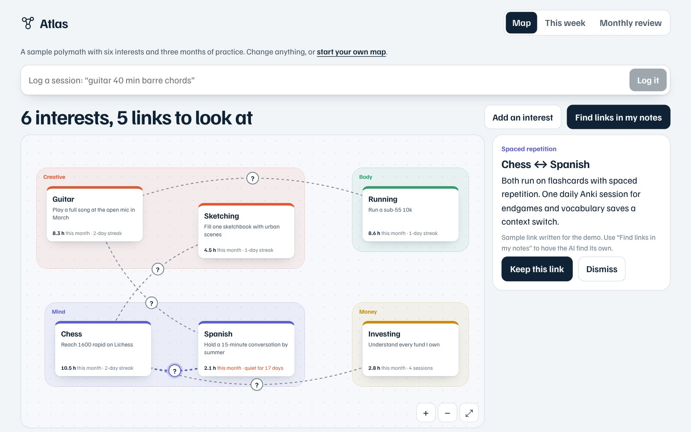

# Atlas

**One map for all your interests.** For people who juggle guitar, chess, Spanish, running and investing at once: every interest is a card on a canvas with its goal, practice log and streak. AI finds real links between them, and a planner balances your week.

Live: **[atlas-smoky-mu.vercel.app](https://atlas-smoky-mu.vercel.app)**

[](https://atlas-smoky-mu.vercel.app)

## What it does

- **The map.** A pan-and-zoom canvas with draggable cards, grouped into Creative, Mind, Body and Money. Interests that have gone quiet for two weeks show it.
- **Log in one line.** "guitar 40 min barre chords" or "1.5 h endgame study" is matched to the right interest, with duration and topic, on the device.
- **Links found in your notes.** A retrieve-then-judge pipeline:
  - Every note is embedded (Gemini embeddings on the free tier, or TF-IDF word vectors when there's no quota).
  - The strongest note pairs across different interests are shortlisted.
  - A model keeps only links that suggest something concrete to do, and says why in a sentence. Example: "Both run on flashcards with spaced repetition: one daily Anki session for endgames and vocabulary."
  - You keep or dismiss each one, and kept links turn solid on the map.
- **A balanced week.** Enter your free minutes per day. A plain, testable scheduler spreads sessions by priority, gives extra time to anything that has gone quiet, and never puts one interest twice in a day.
- **Monthly review.** Minutes per week for 12 weeks per interest, plus a short AI-written review and one next step, grounded in your own numbers.

## How it's built

- React + TypeScript (Vite); everything is kept in the browser (localStorage)
- `api/links.ts`: embeddings → cross-interest candidate pairs (`src/lib/similar.ts`) → an LLM judge with a zod-checked reply; with no judge, it falls back to the strongest matches with a plain explanation
- `api/review.ts`: a short review per interest from its stats and notes
- Free tiers only: Gemini first, Groq as a backup

## Tests

`npm test` covers log parsing, the weekly planner (fits each day, never over the free time, picks a quiet interest back up, no duplicates in a day) and the links pipeline end to end, using TF-IDF and a scripted judge. On the sample notes, TF-IDF alone surfaces Guitar ↔ Running ("metronome at 70 bpm" and "cadence drill with a metronome at 170 bpm").

## Run and deploy

```bash
npm install && npm run dev
```

On Vercel, set `GEMINI_API_KEY` (and optionally `GROQ_API_KEY`).

The sample profile is fictional, and its five starting links were written for the demo and are labelled as samples; "Find links in my notes" runs the real pipeline. Built by [Shrey Gupta](https://shreygupta-three.vercel.app).
